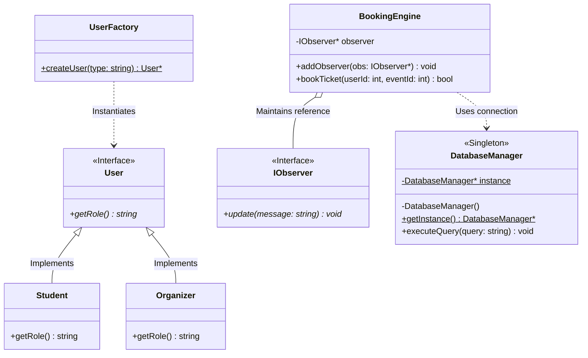

# Campus Event Management System

A robust, non-trivial C++ software application developed following the full Software Development Lifecycle (SDLC). This project was built for the **CSE 3206 - Software Engineering Sessional** to demonstrate architectural design patterns, Test-Driven Development (TDD), and continuous integration.

## Features & Functional Modules

The system is divided into five core functional modules:
1. **User Management:** Handles the creation and role-assignment of users (e.g., Students, Organizers).
2. **Event Catalog:** Manages the creation and tracking of campus events.
3. **Booking Engine:** Allows students to reserve tickets for specific events.
4. **Notification Module:** Automatically sends alerts to users when a booking is confirmed.
5. **Admin Dashboard / Database:** Manages persistent storage and system analytics.

## Architecture & Design Patterns

The system relies on three distinct design patterns spanning Creational and Behavioral categories:

* **Singleton (Creational) - `DatabaseManager`**: Ensures only one active connection to the persistent data store exists, preventing file/database locking.
* **Factory Method (Creational) - `UserFactory`**: Dynamically instantiates different types of users (`Student`, `Organizer`) without cluttering the main logic with conditional blocks.
* **Observer (Behavioral) - `BookingEngine` & `IObserver`**: Decouples the booking logic from the notification system. When a ticket is booked, the engine notifies the observer without needing to know the implementation details of the notification.

## UML Class Diagram



## Testing (TDD & Mocks)

This project utilizes **Google Test (GTest)** and **Google Mock (GMock)**. 
External dependencies (like email/SMS servers in the notification module) are isolated using Mock objects (`MockNotificationService`). The tests were written prior to full implementation following strict Test-Driven Development principles to verify the Observer pattern triggers correctly.

## CI/CD & Self-Directed Tool

**GitHub Actions** is integrated as the primary Continuous Integration tool. 
Upon every push or Pull Request to the `main` branch, a cloud runner automatically:
1. Sets up an Ubuntu environment.
2. Installs CMake, GTest, and GMock.
3. Compiles the C++ source code.
4. Executes the TDD test suite to ensure the build remains stable.

## Local Build Instructions

**Prerequisites:** C++17 Compiler, CMake (>= 3.14), MSYS2/MinGW (for Windows).

```bash
# 1. Generate build files
cmake -B build

# 2. Compile the project
cmake --build build

# 3. Run the automated tests
./build/booking_test
```